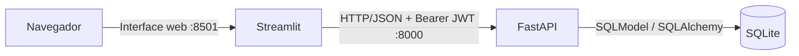
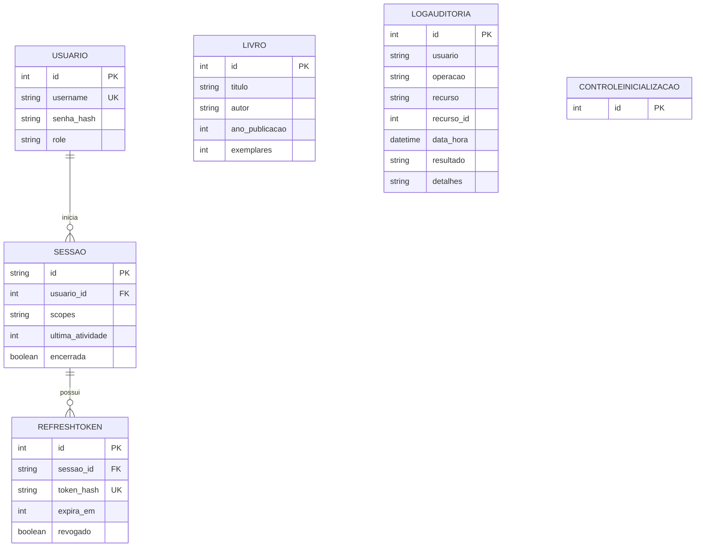

´# Atividade 16/11 — Biblioteca distribuída (versão 9)

**Integrantes:** Gabriel Ceron Bianchi e Thiago Pedro Padilha.

**Repositório:** [iThiago8/AplicacoesDistribuidas](https://github.com/iThiago8/AplicacoesDistribuidas)
— projeto na pasta `atividade-16-11`.

Implementação baseada no roteiro **Estudo de Caso - Sistema Distribuído.pdf**,
seção **4.9 — versão 9**. A alternativa escolhida mantém **Python, FastAPI,
Streamlit, SQLModel e SQLite**, mas substitui o modelo de vendas por um
**catálogo de biblioteca**. O arquivo `GabrielCeronEThiagoPadilhaAvaliacaoParcial.pdf`
é o questionário teórico da disciplina; o roteiro de código está no outro PDF.

## Cenário e funcionalidades

A biblioteca registra títulos, autores, ano de publicação e quantidade de
exemplares. É possível cadastrar, listar, consultar por ID, editar e excluir
livros, buscar por partes do título/autor e filtrar pelo mínimo de exemplares.
O painel apresenta totais de títulos, exemplares e autores do acervo inteiro.
O escopo é o catálogo; empréstimos e devoluções não fazem parte deste modelo.

| Recurso do roteiro até a V9 | Implementação neste projeto |
| --- | --- |
| CRUD, busca e indicadores | `/livros`, `/livros/{id_livro}` e `/livros/resumo` |
| Persistência com ORM | SQLModel/SQLAlchemy e SQLite em `data/biblioteca.db` |
| Cadastro e hash de senhas | `/usuarios`, hash Argon2; contas novas recebem perfil `usuario` |
| Login OAuth2 Password | `POST /token`, formulário `username`, `password` e `scope` opcional |
| Access token JWT e scopes | Assinatura HS256, expiração, `sub`, `sid` e permissões verificadas por rota |
| RBAC | Perfis `usuario` e `admin`, consultados no banco a cada requisição |
| Refresh token | Token aleatório; somente seu hash SHA-256 fica no banco |
| Rotação e renovação automática | `/refresh` consome o token uma única vez; frontend repete a chamada uma vez após 401 |
| Sessão validada pelo backend | `sid`, última atividade persistida, encerramento por inatividade e logout |
| Contadores no frontend | Access token, refresh token e inatividade; relógio sem consultas periódicas à API |
| Auditoria persistente | Cadastro, login, refresh, logout, alterações, timeout e tentativas negadas |
| Tratamento de falhas | Distinção entre 401, 403, validação, recurso inexistente e erro de comunicação |

Os mecanismos intermediários substituídos no roteiro, como armazenamento em
memória e API Key, não são mantidos em paralelo à autenticação da V9.
Redis, rate limiting e infraestrutura das versões posteriores não são necessários.

## Arquitetura



Backend e frontend são processos separados. As chamadas HTTP partem do servidor
Streamlit, por isso o navegador não acessa diretamente o banco ou a API e não
precisa de configuração de CORS. O frontend só conhece o contrato REST.

## Modelo conceitual e MER

**Livro** substitui **Venda**: `id`, `titulo`, `autor`, `ano_publicacao`, `exemplares`.
Título e autor são obrigatórios e têm espaços externos removidos. O ano vai de 1
ao próximo ano; exemplares é um inteiro entre 0 e 100.000. Zero representa um
título sem exemplares no acervo. Os totais são calculados no backend, sem preço
ou faturamento.



O catálogo é compartilhado entre os usuários autenticados. A auditoria guarda
o nome do ator e o ID do recurso como referências históricas, sem FK para livros,
preservando os registros após exclusão. `ControleInicializacao` impede repetir a
carga de demonstração ao reiniciar. A sessão tem tabela própria; isso centraliza
a última atividade e o encerramento, mantendo o comportamento da V9.

## Instalar e executar

Requisito: **Python 3.14** (versão usada na validação), com `venv` e `pip`.
Não é necessário instalar um servidor de banco de dados.

No Linux, a partir da raiz do repositório:

```bash
cd atividade-16-11
python3.14 -m venv .venv
source .venv/bin/activate
python -m pip install -r requirements.txt
uvicorn backend_fastapi:app --reload
```

Em outro terminal, também dentro de `atividade-16-11`:

```bash
source .venv/bin/activate
streamlit run frontend_streamlit.py
```

No Windows/PowerShell, crie o ambiente com `py -3.14 -m venv .venv` e ative com
`.\.venv\Scripts\Activate.ps1` em cada terminal. Os demais comandos são iguais.

- Interface: http://localhost:8501
- API: http://127.0.0.1:8000
- Swagger/OpenAPI: http://127.0.0.1:8000/docs
- Login administrativo inicial: **admin / admin123**

Na primeira inicialização são inseridos três livros de demonstração. Os dados,
usuários, sessões e logs persistem entre reinicializações. Encerre os processos
com `Ctrl+C`.

### Abrir no PyCharm

1. Use **Open** para abrir `atividade-16-11`, que já faz parte do repositório Git.
2. Em **Settings → Project → Python Interpreter**, selecione um ambiente virtual
   Python 3.14 em `.venv` (ou crie-o pela IDE, como no capítulo 2).
3. Abra o terminal integrado com **Alt+F12** e instale `requirements.txt`.
4. Execute `uvicorn backend_fastapi:app --reload`.
5. Abra uma segunda sessão do terminal, ative o mesmo ambiente e execute
   `streamlit run frontend_streamlit.py`.

### Configuração opcional

O sistema funciona localmente sem `.env`. Para personalizar, copie
`.env.example` para `.env` nesta pasta. Os dois processos carregam esse arquivo.

| Variável | Padrão / efeito |
| --- | --- |
| `API_URL` | `http://127.0.0.1:8000`; endereço usado pelo servidor Streamlit |
| `DATABASE_URL` | SQLite em `data/biblioteca.db`, com caminho absoluto baseado na pasta do backend |
| `ADMIN_USERNAME` | `admin`; nome do administrador criado na inicialização |
| `ADMIN_INITIAL_PASSWORD` | `admin123`; usada somente na criação da conta, sem sobrescrever senhas existentes |
| `JWT_SECRET` | Chave didática definida no código; substitua por valor aleatório de pelo menos 32 bytes antes de expor o serviço |
| `SEED_DEMO` | `1`; use `0` antes da primeira inicialização para começar sem livros |

`DATABASE_URL`, quando informado, deve apontar para SQLite; a pasta de destino
deve existir. Reinicie os processos após mudar a configuração. Trocar a chave JWT
invalida os access tokens anteriores. `.env`, `.venv` e `data/` são ignorados pelo Git.
Este é um projeto didático local, com credenciais iniciais conhecidas.

Para executar em máquinas distintas na mesma rede, inicie a API com
`uvicorn backend_fastapi:app --host 0.0.0.0 --port 8000` e configure `API_URL`
com o IP dessa máquina no servidor Streamlit. Para liberar a interface na rede,
execute `streamlit run frontend_streamlit.py --server.address 0.0.0.0`.

## Perfis e sessões

| Operação | Usuário | Administrador |
| --- | --- | --- |
| Consultar acervo, filtros e indicadores | Sim | Sim |
| Cadastrar e editar livros | Sim | Sim |
| Excluir livros | Não | Sim |
| Consultar auditoria | Não | Sim |

O backend aplica todas as permissões, inclusive quando a chamada ignora a
interface. O cadastro público não aceita atribuição de perfil administrativo.
O Swagger permite autenticar pelo botão **Authorize**; use `/token` para testar
também a resposta com o refresh token.

- Access token: **15 minutos**.
- Refresh token: **7 dias**, com novo prazo a cada rotação bem-sucedida.
- Inatividade: **30 minutos**, verificados pelo backend na próxima requisição
  protegida ou renovação. Requisições negadas por falta de escopo não renovam a atividade.
- Logout: encerra a sessão identificada pelo refresh token, revoga seus refresh
  tokens e impede o uso de seus access tokens. Outras sessões do usuário continuam válidas.
- Renovação: mantém o mesmo `sid` e não amplia os scopes concedidos no login;
  a alteração do perfil no banco pode reduzir as permissões imediatamente.
- Falhas de rede: a interface informa o erro e preserva a sessão para nova tentativa.
  O formulário de login não tenta renovar tokens após credenciais inválidas.

O contador visual usa um fragmento Streamlit. Ele não chama `/me` a cada segundo,
evitando que o relógio mantenha uma sessão sem interação artificialmente ativa.
A API é a autoridade dos prazos; não existe um processo agendado apagando sessões.

## Contrato REST

| Método | Rota | Acesso / finalidade |
| --- | --- | --- |
| GET | `/` | Público; disponibilidade |
| POST | `/usuarios` | Público; cadastro com `username` e `senha` |
| POST | `/token` | Público; login em formulário OAuth2 |
| POST | `/refresh` | JSON com `refresh_token`; rotação |
| POST | `/logout` | JSON com `refresh_token`; encerramento da sessão |
| GET | `/me` | Sessão autenticada; perfil e scopes efetivos |
| GET | `/livros` | `livros:read`; filtros `titulo`, `autor`, `min_exemplares` |
| GET | `/livros/resumo` | `livros:read`; totais do acervo |
| GET | `/livros/{id_livro}` | `livros:read`; consulta individual |
| POST | `/livros` | `livros:create`; cadastro |
| PUT | `/livros/{id_livro}` | `livros:update`; substituição dos quatro campos de domínio |
| DELETE | `/livros/{id_livro}` | `livros:delete`; exclusão |
| GET | `/auditoria` | `auditoria:read`; `limite` entre 1 e 500, padrão 100, mais recentes primeiro |

Exemplo de corpo para cadastro/edição de livro:

```json
{
  "titulo": "Dom Casmurro",
  "autor": "Machado de Assis",
  "ano_publicacao": 1899,
  "exemplares": 4
}
```

Respostas: `201` para criação, `200` para consultas/alterações/exclusões,
`401` para autenticação ou sessão inválida, `403` para falta de permissão,
`404` para livro inexistente, `409` para usuário duplicado e `422` para dados
inválidos. Login com scopes não permitidos retorna `400`. Senhas e tokens não
aparecem nos logs de auditoria.

## Verificação e testes

Com o ambiente ativo e nesta pasta:

```bash
python -m pip install -r requirements-dev.txt
python -m pytest -q
```

Os testes usam bancos SQLite temporários e verificam CRUD, filtros, indicadores,
validação, hash de senha, perfis, scopes, persistência, rotação concorrente,
revogação, expiração, inatividade e atomicidade da gravação com auditoria.
Também verificam o cliente HTTP e os fluxos da interface usando Streamlit AppTest.
Não alteram o banco de uso normal.

Validação realizada: **29 testes passaram** em Python 3.14.8.

Para reproduzir as versões exatas do ambiente validado, use
`python -m pip install -r requirements-lock.txt` (inclui as dependências de testes).

Roteiro de demonstração:

1. Entre com `admin / admin123` e confira os três livros e os indicadores.
2. Cadastre um livro, filtre pelo título/autor, edite os exemplares e confirme a exclusão.
3. Abra **Auditoria** e confira o usuário, operação, horário UTC e resultado.
4. Saia e crie uma conta comum: ela pode cadastrar/editar, mas não vê exclusão ou auditoria.
5. Reinicie o backend e confirme que alterações, usuários e logs persistiram.
6. Para demonstrar os limites temporais sem aguardar, execute os testes de
   expiração/inatividade, que ajustam somente o banco temporário e o token de teste.

## Arquivos

| Arquivo | Responsabilidade |
| --- | --- |
| `backend_fastapi.py` | API, autenticação, sessão, regras de autorização e transações |
| `frontend_streamlit.py` | Formulários, catálogo, gestão, contadores e auditoria |
| `api_client.py` | Transporte HTTP, erros, armazenamento local dos tokens e renovação |
| `models.py` | Entidades persistentes e contratos de entrada/saída |
| `requirements*.txt` | Dependências de execução, testes e versões validadas |
| `tests/` | Testes automatizados isolados |

Referências técnicas: [FastAPI — OAuth2 e JWT](https://fastapi.tiangolo.com/tutorial/security/oauth2-jwt/),
[SQLModel — testes com FastAPI](https://sqlmodel.tiangolo.com/tutorial/fastapi/tests/)
e [Streamlit — fragmentos](https://docs.streamlit.io/develop/api-reference/execution-flow/st.fragment).
